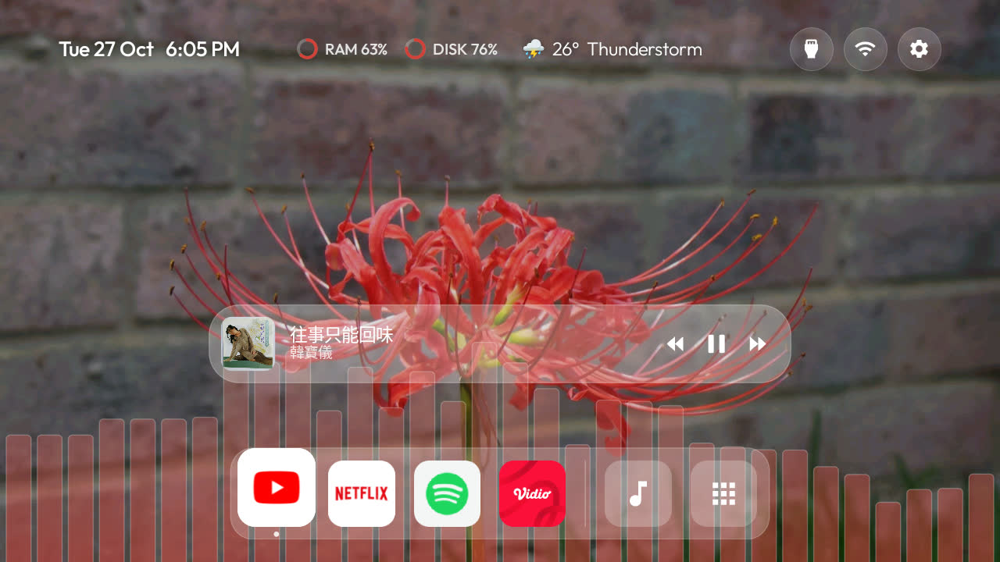

# CleanYourTV macdock

Themes for Android TV and Google TV with a macOS-style Home: a dock, an app panel, a now-playing bar and
a music visualizer. No ads, no tracking, nothing uninstalled.

Built on [CleanYourTV](https://github.com/Gathin23/cleanyourtv), which debloats the TV and installs the
launcher. This fork adds the macOS-style Home and the themes below.

## The collection

| Theme | Look | Push it |
|---|---|---|
| **macdock** | A red spider lily on a grey brick wall. One-line header with RAM and disk rings and the weather, a glass dock, a red visualizer.        | `tools/theme.sh themes/macdock` |

More themes will come. Each one is a folder in [`themes/`](../themes/) with a `config.json`, a
`wallpaper.jpg`, a `screenshot.jpg` and a `CREDITS.md` for its picture.

## What every theme here gets

| Part | What it does |
|---|---|
| Header | Date and time, RAM and disk rings, the weather, and Inputs, Wi-Fi and Settings buttons, all on one line |
| Dock | Your apps in a centred glass band, then a Music button and an Apps button. Left and Right go round. |
| App panel | Down, Menu or the Apps button opens every TV app: recent apps first, then A to Z |
| Icons | One rounded-square shape for every icon |
| Now playing | The song, with previous, play/pause and next. Back hides it. |
| Visualizer | Bars or waves behind the dock while music plays, in a colour taken from the wallpaper |
| Clock in any app | The Info button shows the time for 4 seconds |

Change the music parts with the remote: Apps panel > **Launcher** > **Music**.

## Get it

1. Debloat the TV with [PROMPT.md](../PROMPT.md).
2. Install the launcher and push a theme. [MACDOCK.md](../MACDOCK.md) has the steps, the optional
   weather and music setup, and what it costs on a TV with 1 GB of RAM.

Tested on a TCL 32V51C (G13), Google TV 14.

## Credits

- [CleanYourTV](https://github.com/Gathin23/cleanyourtv) by Gathin23 and its contributors, MIT licence.
- Weather add-on by Sumyabazar1, data from [Open-Meteo](https://open-meteo.com/).
- Each theme's picture is credited in its own `CREDITS.md`.
