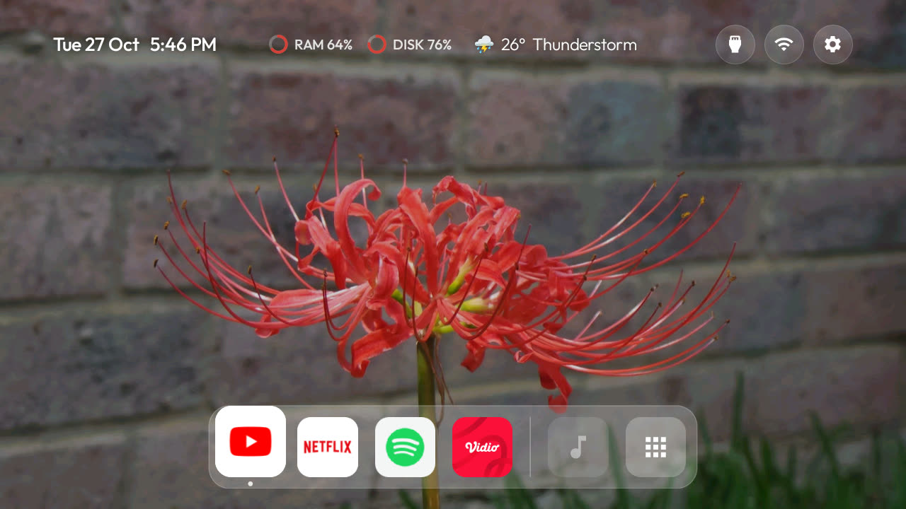

# CleanYourTV macdock

A macOS-style Home for the CleanYourTV launcher. This repo is a fork of
[Gathin23/cleanyourtv](https://github.com/Gathin23/cleanyourtv). The debloat tools, the safety checks and
the rest of the launcher come from there. This fork adds one look, switched on by a theme.



## What you get

| Part | What it does |
|---|---|
| One-line header | Date and time on the left. RAM and disk rings with the weather in the centre. Inputs, Wi-Fi and Settings on the right, each with a name tip that fades. |
| Dock | Your apps in a centred glass band, then a divider, a Music button and an Apps button. Left and Right go round. |
| App panel | Down, Menu or the Apps button opens it. Recent apps first, then every TV app A to Z. Back or Up closes it. |
| Icons | Every icon gets the same rounded-square shape. |
| Now playing | A glass bar above the dock shows the song and has previous, play/pause and next. |
| Visualizer | Bars or waves behind the dock while music plays. They take their colour from the wallpaper. |
| Clock in any app | The Info button shows the time for 4 seconds over any app. |

Each part is off in the launcher by default. The `themes/macdock/` theme turns them on.

## Set it up

You need a computer on the same Wi-Fi as the TV. Read [PROMPT.md](PROMPT.md) and debloat the TV first.

1. Build and install the launcher:

   ```bash
   cd launcher
   HOME_KEY_SERVICE=1 RESTORE_KEY_SERVICES=1 TV_HOST=<tv ip> ./build-and-install.sh
   ```

   `HOME_KEY_SERVICE=1` makes the Info button and remapped buttons work. On some TCL sets it also stops a
   held volume button from repeating. Read the note in [PROMPT.md](PROMPT.md) before you use it.

2. Copy the theme and set your dock:

   ```bash
   cp -R themes/macdock ~/my-macdock
   ```

   In `~/my-macdock/config.json`, add your apps in order, for example
   `"dock_apps": ["com.google.android.youtube.tv", "com.netflix.ninja"]`. Run
   `tools/tv.py 'pm list packages'` to see the package names.

3. Push the theme:

   ```bash
   TV_HOST=<tv ip> tools/theme.sh ~/my-macdock
   ```

4. Optional: show the weather. Build and install [addons/weather](addons/weather/), open it once, and
   choose your city.

5. Optional: show music. On the TV, open the Apps panel, then **Launcher**, then **Music**. Allow
   **Show what is playing**. Allow **Visualizer hears the sound** if you want the visualizer to follow the
   sound. It reads only the speaker output, never the microphone. Without it, the visualizer animates.

## Check it

Take a screenshot of Home:

```bash
TV_HOST=<tv ip> tools/tv.py --screenshot shots/home.png HOME
```

Compare it with [themes/macdock/screenshot.jpg](themes/macdock/screenshot.jpg).

| Part | Correct | Wrong |
|---|---|---|
| Header, left | One small line with the day, date and time, for example "Wed 28 Oct 12:49" | A greeting, a large clock, a divider and the date |
| Header, centre | RAM and disk rings, then the weather | Rings next to the date |
| Header, right | Three round buttons: Inputs, Wi-Fi, Settings | |
| Bottom | The dock, a divider, a Music button and an Apps button | |

A correct dock with a wrong header means the launcher on the TV has local changes. Run `git status` and
`git diff --stat launcher/`. Undo the changes in `launcher/`, then build and install again (step 1).

## For coding agents

- Do not change the launcher source to get this look. `"mac_home": true` in the theme turns on every part.
- For a person's own look, change only the theme folder: `config.json` and `wallpaper.jpg`.
- The macdock header has no greeting and no large clock. With `mac_home` on, these keys do nothing:
  `show_greeting`, `greeting_name`, `date_below_clock`, `shamsi_date`, `lunar_date`, and the greeting
  of a `festival`. Do not patch them back in. If the person asks for a greeting, tell them this look has
  none, and offer a theme without `mac_home`.
- Do the check above before you report that the theme is on the TV.

## Change it

| To change | Do this |
|---|---|
| Player, visualizer style, colour from wallpaper | Apps panel > **Launcher** > **Music**, with the remote |
| Hide the player and visualizer for now | Press the Music button in the dock |
| Wallpaper | Put a 1920x1080 `wallpaper.jpg` in your theme folder and push it again |
| Buttons | Use `app_keys` in the theme, for example `"KEYCODE_INFO:clock"` |
| TCL gear button | Add `"settings_key_keycodes": [83]` to the theme |

All keys are in [themes/README.md](themes/README.md).

## Cost

Measured on a TCL 32V51C with about 1 GB of RAM (Google TV 14):

| State | Launcher CPU |
|---|---|
| Home, no music | Near zero |
| Music with bars | About 17% |
| Music with waves | About 27% |

The visualizer runs only while Home is on screen and music plays.

## Tested on

TCL 32V51C (G13, G13_2K_GB), Google TV 14, build UKN2.241110.001 AU13.

## Credits

- [CleanYourTV](https://github.com/Gathin23/cleanyourtv) by Gathin23 and its contributors, MIT licence.
- Weather add-on by Sumyabazar1, data from [Open-Meteo](https://open-meteo.com/).
- Wallpaper: "Red spider lily (Lycoris radiata)" by Offnfopt, public domain. See
  [themes/macdock/CREDITS.md](themes/macdock/CREDITS.md).
